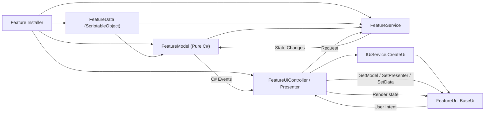

# Empire At War (Unity 6 Project)

An RTS-inspired space-battle game featuring faction control, reinforcements, ship behavior, and economy management. MVP is optional where it fits, especially stateful UI; repository `AGENTS.md` defines the architecture policy.

Start with the [documentation dashboard](EmpireAtWarDocumentation/00_Home.md), [current GameDesign references](EmpireAtWarDocumentation/GameDesign/00_GameDesign.md), and [canonical backlog](EmpireAtWarDocumentation/TODOs/TODOs.md). Proposals, import records, and dated audits are labeled separately from current rules.

---

## 🚀 Technology Stack

* **Game Engine:** **Unity 6** (Editor Version `6000.4.7f1`)
* **Dependency Injection:** **VContainer** (`1.19.0`) with project, scene, player, and entity scopes.
* **Rendering:** **Universal Render Pipeline (URP)** (`17.4.0`) for optimized visual performance.
* **Asset & Data Management:** **Addressables** (`2.9.1`) for dynamic loading of prefabs, visual assets, and databases.
* **Input System:** Unity's **New Input System** (`1.19.0`) for scalable cross-platform controls.
* **Animation Engine:** **DOTween** for smooth UI transitions and procedural visual effects.
* **Agent Toolkit & AI Integrations:**
  * **Unity automation:** Official `unity` CLI and `com.unity.pipeline` bridge, per `AGENTS.md`. Package presence does not override that policy.
  * **Graphify:** A codebase semantic indexing tool used to map dependency trees and query the project graph.

---

## 🏛️ Architecture (Model-View-Presenter)

Use **Model-View-Presenter (MVP)** where its responsibilities fit the feature. Do not force this structure onto small features or entity components.

### Components and Responsibilities:
1. **Model (`Model` / Pure C#):** Contains runtime state, business rules, and standard C# events. It has **no** references to `UnityEngine`, serialized fields, or prefabs.
2. **View (`BaseUi` / `MonoBehaviour`):** Captures UI events and forwards user intent to the Presenter. It contains **no** gameplay logic or service dependencies.
3. **Presenter (`UiController`):** Coordinates model updates with the view, handles initialization, and forwards requests to Services.
4. **Service (`Service`):** Handles application/gameplay flows, background actions, and interactions with external/non-UI systems.
5. **Data (`Data` / ScriptableObject):** Contains static configuration, prefab mappings, and read-only APIs.

---

## 📂 Project Organization

The repository follows a strict **type-first** layout under `Assets/`. Developers and AI agents must place new assets according to these root folders:

* **`Assets/Art/`**: Visual source assets (Models, Textures, Materials, Animation).
* **`Assets/Prefabs/`**: Reusable GameObject configurations (UI screens, unit views).
* **`Assets/Scripts/`**: All C# code, separated into `Components/`, `Entities/`, `Services/`, `Editor/`, and `Tests/`.
* **`Assets/Settings/`**: Global configurations, Input Action maps, and HDRP/URP profiles.
* **`Assets/Plugins/`**: Major external assets; Package Manager dependencies are recorded in `Packages/manifest.json`.
* **`Assets/ThirdParty/`**: External assets or documentation.
* **`Assets/Sandbox/`**: Temporary prototypes, debug scenes, and scratchpads.

---

## 📖 Developer Guides

Ensure you read the relevant document before proposing or implementing changes:

* **[Project organization](EmpireAtWarDocumentation/Architecture/PROJECT_ORGANIZATION.md):** Canonical asset placement reference; root `AGENTS.md` takes precedence over older examples.
* **[UI refactoring playbook](EmpireAtWarDocumentation/Architecture/UI_REFACTORING_PLAYBOOK.md):** UI responsibilities and migration checklist.
* **[Graphify operations](Tools/Graphify/README.md):** Current configured indexing, status, and recovery.
* **[AGENTS.md](AGENTS.md):** Canonical shared instructions and engineering policy.
