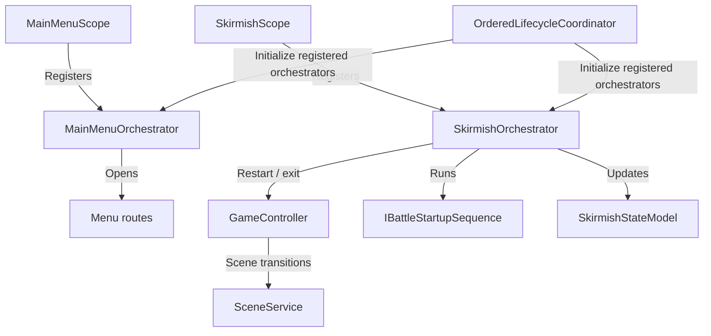
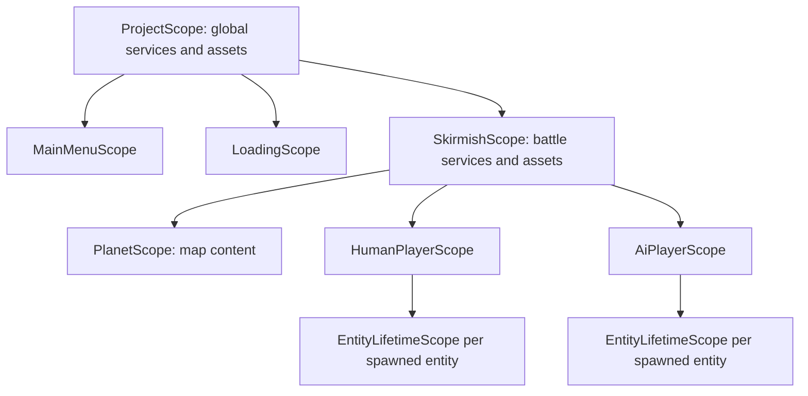
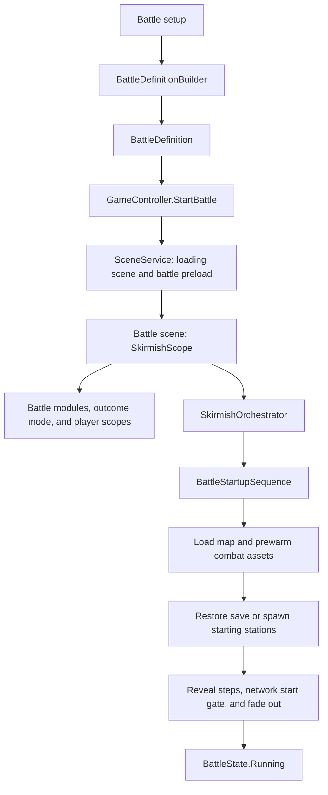
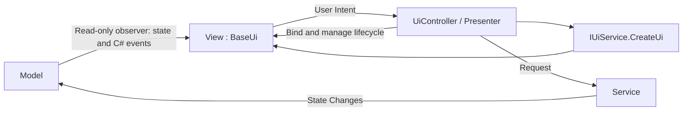
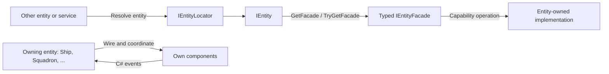
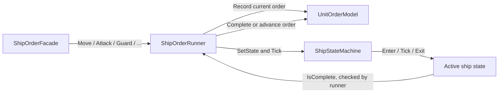

# Empire At War (Unity 6 Project)

An RTS-inspired space-battle game with skirmish, survival, and simulation battle configurations, faction control, reinforcements, ship orders, and economy management. Repository `AGENTS.md` defines the architecture policy.

Start with the [documentation dashboard](EmpireAtWarDocumentation/00_Home.md), [current GameDesign references](EmpireAtWarDocumentation/GameDesign/00_GameDesign.md), and [canonical backlog](EmpireAtWarDocumentation/TODOs/TODOs.md). Proposals, import records, and dated audits are labeled separately from current rules.

---

## 🏛️ Architecture

VContainer scopes compose project, scene, player, and entity dependencies. Use **Model-View-Presenter (MVP)** where its responsibilities fit the feature, especially stateful UI. Do not force this structure onto small features or entity components.

### Main systems and orchestrators

| System | Responsibility |
|---|---|
| [GameController](Assets/Scripts/Entities/Game/GameController.cs) | Stores the battle definition and requests transitions between the main menu and battle scenes. |
| [MainMenuOrchestrator](Assets/Scripts/Entities/MainMenu/MainMenuOrchestrator.cs) | Opens the main menu route; opens the load-game route when returning with a pending load error. |
| [SkirmishOrchestrator](Assets/Scripts/Entities/CoreGame/SkirmishOrchestrator.cs) | Coordinates startup, battle state, pause/speed changes, restart, and exit. Online menu opening does not pause the battle. |
| [BattleStartupSequence](Assets/Scripts/Entities/CoreGame/BattleStartupSequence.cs) | Runs map loading, combat prewarming, restore/spawn, reveal, and the network start gate. |
| [OrderedLifecycleCoordinator](Assets/Scripts/Services/VContainer/Lifecycle/OrderedLifecycleCoordinator.cs) | Dispatches registered initialization and tick callbacks in order; disposes ordered callbacks in reverse, followed by late disposal. |

The diagram separates scene composition from runtime flow: scopes register dependencies; orchestrators coordinate the resulting systems.

### Dependency injection and scope ownership

VContainer builds the object graph through explicit registrations and constructor injection. Scene and prefab references use serialized bindings. The arrows below show parent scopes, not inheritance between C# types.

* [ProjectScope](Assets/Scripts/Services/VContainer/Scopes/ProjectScope.cs) initializes shared assets before building the root container. Scene scopes inherit project dependencies.
* [PlayerScopeBootstrap](Assets/Scripts/Services/VContainer/Scopes/Players/PlayerScopeBootstrap.cs) creates human/AI child scopes and registers per-player factories. `PlanetScope` is a separate child of the battle scope.
* [BaseFactory](Assets/Scripts/Services/Factory/BaseFactory.cs) creates entity child scopes, injects entity components, and registers their lifecycle callbacks. [EntityScopeOwnership](Assets/Scripts/Services/VContainer/Scopes/Entities/EntityScopeOwnership.cs) tracks the spawned scopes for cleanup.
* [AssetLifetimeScope](Assets/Scripts/Services/VContainer/Scopes/AssetLifetimeScope.cs) passes asset access to child scopes. Project and battle scopes own their caches; disposal releases owned handles after container cleanup.
* `OrderedLifecycleCoordinator` drives registered project lifecycle interfaces, including initialization, tick phases, and disposal. DI scope lifetime determines which systems are created and released together.

### Battle setup and startup

[BattleDefinitionBuilder](Assets/Scripts/Entities/Game/BattleDefinitionBuilder.cs) builds and validates a battle definition. [GameController](Assets/Scripts/Entities/Game/GameController.cs) stores it in `GameData` and requests the battle scene. The scene-loading flow passes through the loading scene and asset preloading before loading the battle additively.

Despite its name, [SkirmishScope](Assets/Scripts/Services/VContainer/Scopes/SkirmishScope.cs) composes all three battle outcomes. `BattleModes` selects skirmish, survival, or simulation behavior from `BattleDefinition.Outcome`. [BattleStartupSequence](Assets/Scripts/Entities/CoreGame/BattleStartupSequence.cs) separates startup from [SkirmishOrchestrator](Assets/Scripts/Entities/CoreGame/SkirmishOrchestrator.cs), which manages battle flow and the startup input lock. Squadron prewarming and initial station spawning are authority-dependent.

Battle modules configure economy, capture sites, fog, and superweapons according to `BattleFeatures`. Player scopes separate AI and human players, with per-player unit factories and local-player configuration.

### UI flow

### UI responsibility guidelines

1. **Model (`Model` / Pure C#):** Contains runtime state, business rules, and standard C# events. It has **no** references to `UnityEngine`, serialized fields, or prefabs.
2. **View (`BaseUi` / `MonoBehaviour`):** Renders state, subscribes to model events through read-only observer interfaces, and forwards user intent to the Presenter. It contains **no** gameplay logic and releases its subscriptions during disposal.
3. **Presenter (`UiController`):** Coordinates view creation, binding, and lifecycle; handles user actions and forwards requests to Services. It subscribes to model events when the reaction exceeds the View's scope.
4. **Service (`Service`):** Handles application/gameplay flows, background actions, and interactions with external/non-UI systems.
5. **Data (`Data` / ScriptableObject):** Contains static configuration, prefab mappings, and read-only APIs.

For a concrete observer flow, [EconomyUiController](Assets/Scripts/Entities/Economy/Ui/EconomyUiController.cs) creates the view, calls `SetModel` and `Initialize`; [EconomyUi](Assets/Scripts/Entities/Economy/Ui/EconomyUi.cs) renders money and subscribes directly to `OnMoneyChanged`.

### Entity communication

* Entities communicate through `IEntity`, `IEntityLocator`, and typed `IEntityFacade` contracts resolved with `TryGetFacade` / `GetFacade`. `IEntity` exposes no Unity types; transform access uses `IEntityTransformFacade`.
* Each entity connects its own components through interfaces and C# events. Components do not command siblings or receive their owning entity as a mediator.

Contracts: [IEntity](Assets/Scripts/Entities/BaseEntity/Entity.cs), [IEntityLocator](Assets/Scripts/Entities/BaseEntity/EntityMediator.cs), and [IEntityFacade](Assets/Scripts/Entities/BaseEntity/IEntityFacade.cs).

### Ship order execution

[ShipOrderFacade](Assets/Scripts/Entities/Ship/EntityFacades/ShipOrderFacade.cs) exposes movement, attack, guard, and other order capabilities. [ShipOrderRunner](Assets/Scripts/Entities/Ship/Orders/ShipOrderRunner.cs) selects states and advances orders when the active state reports completion.

Move, waypoint, and retreat orders use `NavigateState`; attack uses `AttackTargetState`; attack-move, guard, hunt, and idle have their own states. States do not choose the next state themselves.

---

## 🚀 Technology Stack

* **Game Engine:** **Unity 6** (Editor Version `6000.4.7f1`)
* **Dependency Injection:** **VContainer** (`1.19.0`) with project, scene, player, and entity scopes.
* **Rendering:** **Universal Render Pipeline (URP)** (`17.4.0`), with quality profiles under `Assets/Settings/Render Pipelines/`.
* **Asset loading:** **Addressables** (`2.9.1`), wrapped by `AddressableHandleLoader` and scope-owned `CachedAssetService` for loading, preloading, and releasing asset handles.
* **Input:** Unity **Input System** (`1.19.0`), using `EmpireAtWar.inputactions`, generated `GameInputActions`, and `InputActionsProvider`.
* **Tweening:** **DOTween**, including UI fades in `FadeUi`.
* **Agent Toolkit & AI Integrations:**
  * **Unity automation:** Official `unity` CLI and `com.unity.pipeline` bridge, per `AGENTS.md`. Package presence does not override that policy.
  * **Graphify:** A codebase semantic indexing tool used to map dependency trees and query the project graph.
  * **Serena:** Live C# symbol navigation, references, and surgical edits through the checkout's shared backend.

Editor and package versions are recorded in [ProjectVersion.txt](ProjectSettings/ProjectVersion.txt) and [manifest.json](Packages/manifest.json); Git dependencies are pinned by commit.

---

## 📂 Project Organization

The repository follows a strict **type-first** layout under `Assets/`. Developers and AI agents must place new assets according to these root folders:

* **`Assets/Art/`**: Visual source assets (Models, Textures, Materials, Animation).
* **`Assets/Audio/`**: Music, sound effects, voices, and the audio mixer.
* **`Assets/Prefabs/`**: Reusable GameObject configurations (UI screens, unit views).
* **`Assets/Scenes/`**: Main menu, loading, battle, and planet scenes.
* **`Assets/Scripts/`**: Project-owned C# code, separated into `BaseSystem/`, `Components/`, `Entities/`, `Services/`, `Editor/`, `Tests/`, and `Utils/`.
* **`Assets/Settings/`**: Configuration assets, Input Action maps, and URP render pipeline profiles.
* **`Assets/Plugins/`**: Major external assets; Package Manager dependencies are recorded in `Packages/manifest.json`.
* **`Assets/ThirdParty/`**: External assets or documentation.
* **`Assets/Sandbox/`**: Temporary prototypes, debug scenes, and scratchpads.
* **`Assets/Resources/`**: Bootstrap assets, currently `ProjectContext` and DOTween settings; keep this folder minimal.

---

## 📖 Developer Guides

Ensure you read the relevant document before proposing or implementing changes:

* **[Project organization](EmpireAtWarDocumentation/Architecture/PROJECT_ORGANIZATION.md):** Canonical asset placement reference; root `AGENTS.md` takes precedence over older examples.
* **[UI refactoring playbook](EmpireAtWarDocumentation/Architecture/UI_REFACTORING_PLAYBOOK.md):** UI responsibilities and migration checklist.
* **[UI/UX guidelines](EmpireAtWarDocumentation/Rules/UI_UX_GUIDELINES.md)** and **[UI code build guide](EmpireAtWarDocumentation/Rules/UI_CODE_BUILD_GUIDE.md):** Required guidance for UI changes and new UI features, respectively.
* **[Graphify operations](Tools/Graphify/README.md):** Current configured indexing, status, and recovery.
* **[Serena operations](Tools/Serena/README.md):** Shared C# backend setup and lifecycle.
* **[AGENTS.md](AGENTS.md):** Canonical shared instructions and engineering policy.
